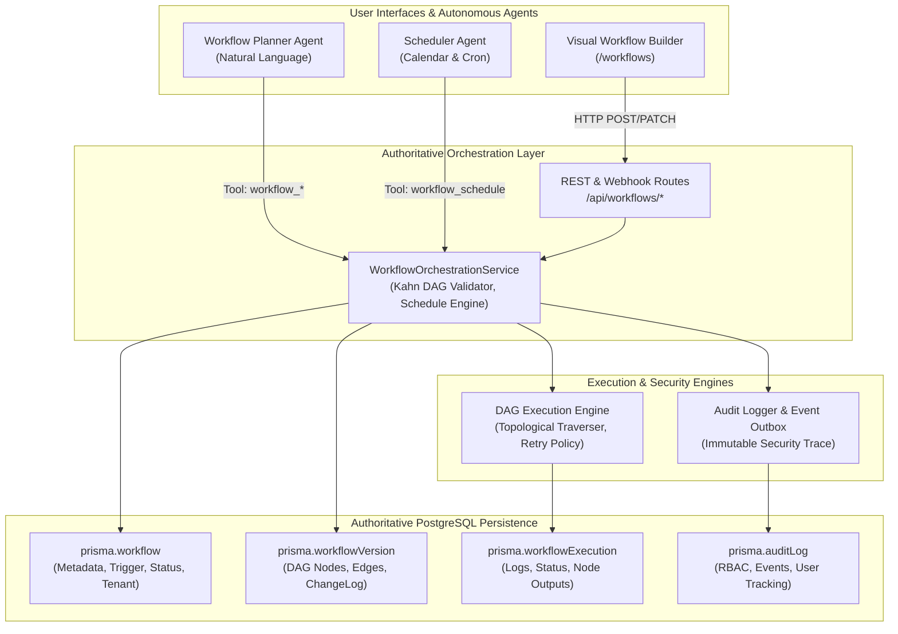
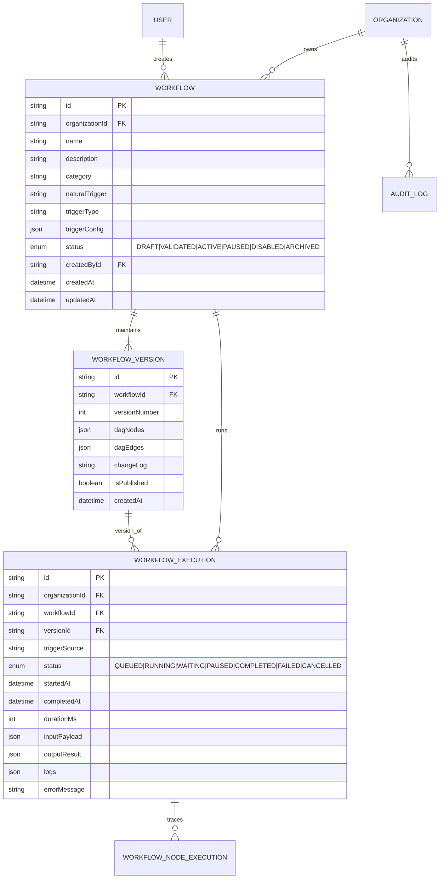

# FlowMind AI — Unified Workflow Orchestration Architecture

**Authoritative Specification & Technical Architecture Document**  
**Version:** 2.0 Enterprise  
**Status:** VALIDATED & DEPLOYED  
**Date:** November 18, 2026  

---

## 1. Executive Architecture Summary

FlowMind AI has transitioned from a dual-state in-memory model to a **Unified PostgreSQL-Authoritative Workflow Orchestration Architecture**. 

Prior to this upgrade:
- The **Visual Workflow DAG Automation page** (`/workflows`) saved workflows into a local in-memory JavaScript map (`workflowStorage`).
- The **Workflow Planner AI Agent** (`Workflow`) and **Scheduler AI Agent** (`Scheduler`) were unaware of visually compiled workflows and relied on synthetic fallback mock definitions.
- Workflow schedules were volatile and could not survive process restarts or cross-session state changes.

### The Unified State Model
All components in FlowMind AI now interface through an authoritative orchestration layer:
1. **Visual Workflow DAG Automation Page** (`/workflows`)
2. **Workflow Planner AI Agent** (`Workflow`)
3. **Scheduler AI Agent** (`Scheduler`)
4. **DAG Execution Engine** (`workflowEngine.ts`)
5. **REST & Webhook API Endpoints** (`/api/workflows/*`)
6. **PostgreSQL Relational Storage** (`workflows`, `workflow_versions`, `workflow_executions`, `audit_logs`)

---

## 2. PostgreSQL Authoritative Data Model

Persistence is strictly enforced in PostgreSQL using Prisma ORM. In-memory data structures are strictly downstream read-through caches.

### 2.1 Entity Relationship Diagram

### 2.2 Immutability and Versioning
- **Workflow Versioning:** Whenever DAG topology (nodes, edges, condition expressions) is altered, `WorkflowOrchestrationService` validates the graph with Kahn's algorithm and creates a new immutable record in `workflow_versions` with an incremented `versionNumber`.
- **Zero In-Memory Disconnect:** Both the Visual UI and AI Agents read from `WorkflowOrchestrationService.getWorkflow()` which always joins the latest published version from `workflow_versions`.

---

## 3. End-to-End Orchestration Lifecycle

### 3.1 Visual Creation & Agent Synchronization
1. User enters natural language prompt or drags DAG nodes in `/workflows`.
2. The UI issues an HTTP `POST /api/workflows` containing node topology, edges, and trigger specifications.
3. `WorkflowOrchestrationService.createWorkflow()` validates the DAG for acyclicity, persists `prisma.workflow` and `prisma.workflowVersion`, and emits `WORKFLOW_CREATED` to `prisma.auditLog`.
4. When the user subsequently queries the **Workflow Planner Agent** (`"Show me all workflows I have created"`), the agent executes the `workflow_list` tool, retrieving the PostgreSQL record instantly.

### 3.2 Schedule Registration & Rescheduling
1. User requests: `"Schedule a meeting at 9:00 AM tomorrow."`
2. **Scheduler Agent** generates meeting invite parameters and calls `workflowOrchestrationService.createWorkflow()` with `category: 'MEETING'`, `triggerType: 'schedule'`, and Indian Standard Time (`Asia/Kolkata (IST)`).
3. Record is written to `workflows` with `triggerConfig.scheduledTime = "Tomorrow at 9:00 AM IST"`.
4. User subsequently requests: `"Update the meeting workflow to 10 AM."`
5. **Scheduler Agent** identifies the meeting workflow via `workflow_reschedule`, recalculates `nextRunAt`, and updates PostgreSQL.
6. Queries to either **Scheduler Agent** or **Workflow Agent** reflect the updated 10:00 AM execution window.

### 3.3 Pause and Resume Governance
1. User requests: `"Pause the workflow that sends payment reminders."`
2. Workflow Agent executes `workflow_pause`, which transitions `status` to `PAUSED` in PostgreSQL and emits a `WORKFLOW_PAUSED` audit event.
3. The DAG execution engine rejects incoming webhook/cron trigger executions for paused workflows.
4. User requests: `"Activate the workflow that sends payment reminders."`
5. Workflow Agent executes `workflow_activate`, restoring `ACTIVE` status in PostgreSQL.

---

## 4. Multi-Tenant Isolation & Security Boundary

FlowMind AI enforces strict tenant isolation:
- All queries to `WorkflowOrchestrationService` require an `organizationId`.
- Workflows belonging to Organization `A` (e.g., `ORG-AUDIT-2026`) cannot be read, updated, or executed by users belonging to Organization `B` (e.g., `ORG-01`).
- Shared system templates are explicitly isolated under `ORG-01` with `isTemplate: true`.
- Role-Based Access Control (`RBAC`) requires `WORKFLOW_CREATE` permissions for workflow mutations.
