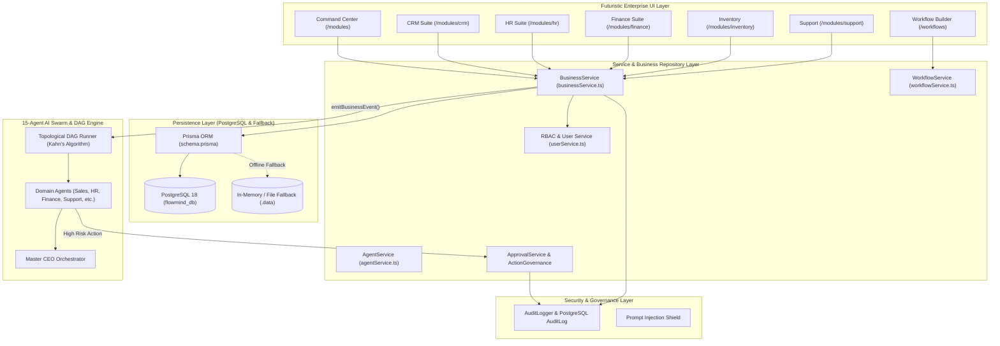
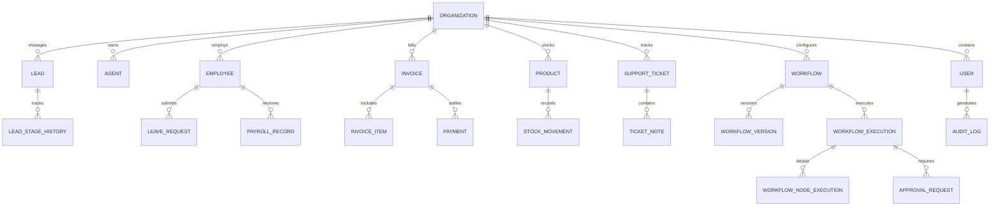

# FLOWMIND AI — COMPREHENSIVE IMPLEMENTATION PROGRESS REPORT
## Integrated Enterprise AI Business Operating System & Autonomous Workflow Suite
### Academic Capstone Project Progress Report (Weeks 1 – 5 Implementation)

---

## 1. Title Page

* **Project Title**: FlowMind AI — Multilingual Autonomous AI Business Operating System
* **Sub-Title**: Deep Integration of 15-Agent Swarm Mesh, Natural Language DAG Workflow Automation, and Enterprise Business Operations Suite (CRM, HR, Finance, Inventory, Support) with PostgreSQL & 3-Tier RBAC
* **Academic Institution**: Department of Computer Science and Engineering, School of Computer Science and Engineering (SCOPE), VIT-AP University, Amaravati, Andhra Pradesh, India
* **Course Code & Program**: Capstone Project / B.Tech Computer Science and Engineering (2022–2026)
* **Academic Term**: Semester VII (Academic Year 2026)
* **Document Version**: 5.2.0 (Milestone: Week 5 Completion & Verification)
* **Date of Evaluation**: October 2026
* **Repository Reference**: [GitHub Repository: Furkhan-5/FlowMind-AI](https://github.com/Furkhan-5/FlowMind-AI) (Branch: `main`)

### Capstone Project Team Details

| Team Member Name | Registration Number | Degree & Specialization | Project Domain Allocation | Primary Architectural Responsibilities |
| :--- | :--- | :--- | :--- | :--- |
| **Furkhan Abdul Raheem** | **23BCE7868** | B.Tech CSE | **AI Lead & Systems Architect** | Master CEO Orchestrator, 15-Agent Swarm Mesh, Universal Agent Runtime, Indic Multilingual Engine, Prompt Injection Shield. |
| **Aniket Sahu** | **23BCE7881** | B.Tech CSE | **Frontend & Layman UX Lead** | Futuristic Design System, Layman Accessible Chatbot, Thought Stream Visualizer, Action Confirmation Cards, Responsive Layouts. |
| **Anjali Karagatla** | **23BCE8077** | B.Tech CSE | **Workflow Engine Lead** | NL-to-DAG Planner, Topological DAG Runner, DAG Visualizer, Execution Console, Event Bridge, Background Job Dispatcher. |
| **Farukh** | **23BCE20345** | B.Tech CSE | **Data, Security & RBAC Lead** | PostgreSQL Relational Layer, Prisma ORM Schema, 3-Tier RBAC, Action Governance Risk Evaluator, Audit Logger, Data Exports. |

---

## 2. Executive Summary

Enterprise software ecosystems today suffer from deep fragmentation: organizations run disparate tools for Customer Relationship Management (CRM), Human Resources (HR), Financial Invoicing, Inventory Warehousing, and Customer Helpdesk Support. In addition to data silos, non-technical business operators face significant complexity when attempting to automate multi-step operational procedures across these software tools.

**FlowMind AI** resolves this systemic inefficiency by developing a unified, **Multilingual AI Business Operating System**. By consolidating five core enterprise domains—**CRM, HR, Finance, Inventory, and Support**—under a single architectural umbrella, FlowMind AI empowers non-technical users to orchestrate autonomous AI agents, execute complex DAG-based workflows via natural language, and manage enterprise operations with full relational persistence and governance.

As of **Week 5**, the project has successfully expanded beyond conversational intelligence and workflow automation into a fully integrated **Enterprise Business Operations Suite**:
1. **Business Operations Command Center (`/modules`)**: A centralized dashboard delivering real-time cross-module Key Performance Indicators (KPIs), genuine data-driven FlowMind AI Insights, quick operational triggers, and unified multi-entity global search across leads, staff, invoices, and tickets.
2. **Domain Modules (`/modules/crm`, `/hr`, `/finance`, `/inventory`, `/support`)**: Dedicated operational interfaces featuring visual CRM pipeline tracking with 7 distinct stages, staff directories with strict salary masking, leave request management with anti-self-approval enforcement, automated payroll processing, GST-compliant invoice generation with printable previews and PDF downloads, stock movement logging with automated low-stock warnings, and SLA-aware support ticket resolution.
3. **Enterprise Data Persistence & Hybrid Resilience**: An enterprise PostgreSQL relational database orchestrated by Prisma ORM comprising **22 relational data models** (10 foundational models + 12 Week 5 business models). Crucially, the service layer implements resilient hybrid fallback mechanisms that operate seamlessly across local PostgreSQL instances (`localhost:5432`) and in-memory caches, guaranteeing high availability.
4. **Action Governance & 3-Tier RBAC**: Full enforcement of role permissions across `ADMIN`, `MANAGER`, and `EMPLOYEE` tiers, enforcing strict salary data masking, anti-self-approval restrictions, and granular audit logging.

All code has been verified through strict TypeScript type compilation (`tsc --noEmit`), Next.js optimized production builds (`npm run build` across 25 routes), automated database migrations (`prisma db push`), and seed initialization (`npm run db:seed`).

---

## 3. Project Overview and Technology Stack

FlowMind AI is architected as a high-performance, full-stack Next.js 14 web application combining modern web technologies, 3D interactive graphics, asynchronous workflow computation, and relational enterprise persistence.

### Technology Stack Matrix

| Architectural Layer | Technologies Employed | Exact Versions & Dependencies | Purpose & Function |
| :--- | :--- | :--- | :--- |
| **Core Framework** | Next.js (App Router), React | Next.js `14.2.35` / React `18.3.1` | Server-side rendering, API route handlers, client-side streaming, static page optimization. |
| **Programming Language**| TypeScript | TypeScript `5.4.5` (Strict Mode) | Full-stack static typing, interface contracts, compile-time safety. |
| **Styling & Design System**| Tailwind CSS, Lucide Icons, GSAP | Tailwind `3.4.3`, Lucide `0.368.0`, GSAP `3.15.0` | Custom glassmorphism design tokens, fluid animations, futuristic enterprise dashboard styling. |
| **3D Graphics & Visuals** | Three.js, React Three Fiber, Drei | Three `0.163.0`, R3F `8.16.0`, Drei `9.105.0` | 3D interactive landing canvas, interactive agent mesh spatial node rendering. |
| **Data Persistence** | PostgreSQL, Prisma ORM | PostgreSQL `16`/`18`, Prisma Client `5.19.1` | Relational multi-tenant data storage, connection pooling, typed database queries. |
| **State Management** | Zustand | Zustand `4.5.2` | Global application client state (active user session, chat messages, active agent, toast alerts). |
| **Authentication & RBAC**| Jose, BcryptJS | Jose `6.2.12`, BcryptJS `3.0.3` | JWT generation/verification, HTTP-Only session cookies, cryptographic password hashing (salt 10). |
| **Data Visualization** | Recharts | Recharts `2.12.5` | Pipeline conversion charts, revenue breakdowns, operational velocity metrics. |
| **Document Generation** | Browser Canvas / Dynamic HTML API | Native Print Engine, Blob File Streamer | GST-compliant tax invoice formatting, client-side print view, and PDF downloads. |

### Directory & Repository Organization

```text
C:\Capstone
├── .data/                                # Local JSON persistence store fallback
├── docs/                                 # Project documentation & technical reports
│   ├── FLOWMIND_AI_IMPLEMENTATION_PROGRESS_REPORT.md
│   └── week5-business-operations.md
├── prisma/
│   ├── schema.prisma                     # 22 relational database models & enums
│   └── seed.ts                           # Enterprise database seeder (Orgs, Users, Agents, Workflows)
├── public/                               # Static assets, branding vectors, icons
├── scratch/                              # Diagnostic & verification test scripts
├── src/
│   ├── app/                              # Next.js 14 App Router
│   │   ├── (auth)/                       # Login, Signup, Forgot Password, Reset Password
│   │   ├── api/                          # Backend API routes (Auth, Workflows, Webhooks)
│   │   ├── dashboard/                    # Classic FlowMind AI workspace dashboard
│   │   ├── modules/                      # Week 5 Business Operations Hub
│   │   │   ├── crm/page.tsx              # CRM Pipeline & Customer 360
│   │   │   ├── hr/page.tsx               # HR Directory, Leaves, & Payroll
│   │   │   ├── finance/page.tsx          # Finance Invoicing & GST Engine
│   │   │   ├── inventory/page.tsx        # Hardware Catalog & Stock Movement
│   │   │   ├── support/page.tsx          # Ticket Queue & SLA Manager
│   │   │   └── page.tsx                  # Business Operations Command Center
│   │   ├── workflows/                    # DAG Workflow Builder & Runner
│   │   ├── layout.tsx                    # Global root layout & theme provider
│   │   └── page.tsx                      # 3D interactive landing page
│   ├── components/                       # Modular UI component library
│   │   ├── layout/                       # Navbar, Sidebar, Top Taskbar, Footer
│   │   ├── ui/                           # Button, GlassCard, Badge, Modal, Drawer
│   │   └── workflow/                     # VisualDAGGraph, NodeConfigPanel, ExecutionConsole
│   ├── lib/
│   │   ├── auth/                         # Session cookie handlers, JWT validation, db fallback
│   │   ├── security/                     # AuditLogger, PromptInjectionShield, ActionGovernance
│   │   ├── services/                     # Business logic & repository services
│   │   │   ├── agentService.ts           # AI Swarm agent task logging & stats
│   │   │   ├── approvalService.ts        # Action governance & approval resolution
│   │   │   ├── auditService.ts           # PostgreSQL audit persistence
│   │   │   ├── businessService.ts        # Week 5 CRM, HR, Finance, Inventory, Support services
│   │   │   ├── rbacService.ts            # Permission checks & role guards
│   │   │   ├── userService.ts            # User CRUD & password authentication
│   │   │   └── workflowService.ts        # Workflow DAG persistence & execution state
│   │   ├── store/                        # Zustand application stores
│   │   ├── utils/                        # Invoice generator, formatters, sanitizers
│   │   └── workflow/                     # Topological sort, DAG validator, condition evaluator
│   └── types/                            # TypeScript interfaces & domain types
│       ├── business.ts                   # Week 5 domain data interfaces
│       ├── index.ts                      # Shared types & exports
│       └── workflowDSL.ts                # DAG schema & node definitions
├── package.json
└── tsconfig.json
```

---

## 4. Original Project Objectives

The primary academic capstone goal of FlowMind AI is to build a next-generation enterprise platform that bridges high-level natural language intent with automated, deterministic business operations. The official 8-week project timeline is divided as follows:

1. **Week 1 (Foundation & UI Design System)**: Establish software architecture, responsive layout, glassmorphic UI components, and design token infrastructure.
2. **Week 2 (Layman Chatbot & Multilingual Engine)**: Develop layman-accessible natural language conversational interface, Thought Stream visualizer, Action Cards, and Indic multilingual translation framework.
3. **Week 3 (Multi-Agent Mesh & Action Governance)**: Architect the 15-Agent AI Swarm, Master CEO Orchestrator, human-in-the-loop Action Cards, Action Governance risk rating, and prompt injection defense.
4. **Week 4 (Natural Language Workflow Automation Engine)**: Implement NL-to-DAG Planner, Kahn's topological sort execution runner, interactive visual DAG builder, background job queue, and webhook/cron trigger dispatchers.
5. **Week 5 (Integrated Business Operations Suite)**: Build persistent, unified business modules across CRM, HR, Finance, Inventory, and Support, integrated with PostgreSQL, Prisma ORM, 3-Tier RBAC, and event-driven workflow hooks.
6. **Week 6 (Enterprise Analytics, RAG Knowledge Hub & Advanced Governance)**: Real-time business intelligence charts, vector-based semantic retrieval, cross-module agent collaboration, and automated compliance reporting *(Scheduled)*.
7. **Week 7 (System Hardening, Performance Optimization & Stress Testing)**: End-to-end integration testing, database query profiling, latency benchmarking, and automated regression suite *(Scheduled)*.
8. **Week 8 (Final Capstone Demonstration, Documentation & Presentation)**: Final defense presentation, project viva demonstration, faculty review deliverables, and deployment packaging *(Scheduled)*.

---

## 5. Week-by-Week Implementation Progress

### Week 1: SDLC Architecture, Design System & Foundation Setup
* **Accomplishments**: Initialized Next.js 14 App Router project with TypeScript; configured Tailwind CSS utility classes, glassmorphic card containers, fluid animations with GSAP, and dark/light theme switching with persistent localStorage settings. Created modular layout elements including the responsive navigation bar, top workspace taskbar, and classic desktop dashboard structure.
* **Evidence**: `src/app/layout.tsx`, `src/components/layout/Navbar.tsx`, `src/components/ui/GlassCard.tsx`, `tailwind.config.ts`.

### Week 2: Layman Chatbot Foundation & Indic Multilingual Engine
* **Accomplishments**: Implemented an intuitive conversational interface specifically tailored for non-technical enterprise operators. Developed the **Thought Stream** component to render real-time cognitive deliberation steps of AI agents. Created interactive **Action Cards** enabling users to review parameters and confirm actions before execution. Built a multi-language dictionary mapping queries across English, Hindi, Telugu, Tamil, Kannada, Malayalam, and Odia.
* **Evidence**: `src/components/chat/ChatInterface.tsx`, `src/components/chat/ThoughtStream.tsx`, `src/components/chat/ActionCard.tsx`, `src/lib/i18n/`.

### Week 3: 15-Agent AI Swarm Mesh & Universal Action Governance
* **Accomplishments**: Implemented the **Universal Agent Mesh** consisting of 15 specialized domain agents (CEO Orchestrator, Sales, Marketing, Finance, HR, Support, Analytics, Database, Workflow, Scheduler, Document, Email, Knowledge, Reporting, Security). Built the Master Orchestrator to decompose complex natural language requests into sub-tasks. Developed the **Action Governance** framework classifying actions into `LOW`, `MEDIUM`, `HIGH`, and `CRITICAL` risk categories, requiring explicit human approval for high-risk operations. Embedded a heuristic **Prompt Injection Shield** to sanitize malicious inputs.
* **Evidence**: `src/lib/agents/`, `src/lib/security/actionGovernance.ts`, `src/lib/security/promptInjectionShield.ts`, `src/types/agent.ts`.

### Week 4: Natural Language Workflow Automation Engine
* **Accomplishments**: Created a complete zero-code workflow engine. Built the **Workflow Planner** to parse natural language descriptions into structured DAG JSON specifications. Developed a **DAG Validator** running cycle detection and Kahn's algorithm for topological ordering. Built the interactive visual workflow canvas at `/workflows` with node configuration panels and live execution runner consoles. Supported background retries with exponential backoff, inbound webhooks (`/api/workflows/webhook/[workflowId]`), scheduled cron execution, and variable interpolation (`{{trigger.x}}`).
* **Evidence**: `src/app/workflows/page.tsx`, `src/lib/workflow/workflowEngine.ts`, `src/lib/workflow/dagValidator.ts`, `src/lib/workflow/workflowPlanner.ts`, `src/types/workflowDSL.ts`.

### Week 5: Integrated Enterprise Business Operations Suite
* **Accomplishments**: Extended FlowMind AI into a unified business operating platform. Created the Command Center (`/modules`) and five specialized domain modules: CRM, HR, Finance, Inventory, and Support. Integrated 12 new relational database models into PostgreSQL via Prisma ORM. Built cross-module Customer 360 and Employee 360 aggregations. Enforced 3-tier RBAC (`ADMIN`, `MANAGER`, `EMPLOYEE`) with confidential salary masking and anti-self-approval leave policies. Built an event-driven workflow bridge connecting operational events directly to the DAG automation engine. Verified clean production compilation across all 25 routes.
* **Evidence**: `src/app/modules/`, `src/lib/services/businessService.ts`, `prisma/schema.prisma`, `src/types/business.ts`, `prisma/seed.ts`.

---

## 6. Implementation Progress Matrix

The following progress matrix reflects the actual state of the codebase evaluated against verifiable evidence:

| Week / Objective | Planned Deliverable | Actual Implementation | Codebase Evidence | Status | Remaining Work |
| :--- | :--- | :--- | :--- | :---: | :--- |
| **W1: UI Foundation** | Responsive Layout & Design System | Glassmorphic cards, Navbar, Dark/Light theme, 3D Canvas | `src/app/page.tsx`, `src/components/ui/GlassCard.tsx` | **COMPLETED** | Mobile hamburger drawer polish. |
| **W2: Layman Chat** | Conversational Chatbot & Thought Stream | Streaming messages, agent thought traces, Action Cards | `src/components/chat/ThoughtStream.tsx`, `ActionCard.tsx` | **COMPLETED** | WebSocket live agent streaming. |
| **W2: Multilingual** | Indic Language Translation | Query detection & translation across 7 Indic languages | `src/lib/i18n/`, `src/components/layout/Navbar.tsx` | **COMPLETED** | Voice input transcription (STT). |
| **W3: Agent Swarm** | 15 Domain AI Agents | 15 specialized agents seeded, routed via CEO agent | `src/lib/agents/`, `prisma/seed.ts`, `agentService.ts` | **COMPLETED** | External LLM API key provider toggle. |
| **W3: Governance** | Risk Assessment & Approval System | 4-tier risk classification, human-in-the-loop modal | `src/lib/security/actionGovernance.ts`, `approvalService.ts` | **COMPLETED** | Multi-approver quorum voting. |
| **W3: Security** | Prompt Injection Defense | Heuristic pattern matching & input sanitization | `src/lib/security/promptInjectionShield.ts` | **COMPLETED** | Vector semantic jailbreak detector. |
| **W4: NL Planner** | Natural Language to DAG Conversion | Deterministic DSL generator from user prompts | `src/lib/workflow/workflowPlanner.ts`, `workflowDSL.ts` | **COMPLETED** | Fine-tuned LLM JSON schema enforcement. |
| **W4: DAG Engine** | Topological Sort & Execution Runner | Kahn's algorithm, node dependency execution, retries | `src/lib/workflow/workflowEngine.ts`, `dagValidator.ts` | **COMPLETED** | Distributed Redis worker queue. |
| **W4: Builder UI** | Visual DAG Graph & Config Panel | Canvas graph rendering, node inspector, run console | `src/app/workflows/page.tsx`, `VisualDAGGraph.tsx` | **COMPLETED** | Drag-and-drop node edge connector. |
| **W4: Triggers** | Webhook & Cron Scheduling | Webhook route handler, cron pattern simulator | `src/app/api/workflows/webhook/[workflowId]/route.ts` | **COMPLETED** | Persistent BullMQ background timers. |
| **W5: Database** | PostgreSQL & Prisma Persistence | 22 Prisma relational models, migrations, DB seeder | `prisma/schema.prisma`, `prisma/seed.ts`, `scratch/verifyDb.ts`| **COMPLETED** | Automated Prisma migration CI script. |
| **W5: Hub** | Command Center (`/modules`) | Aggregated metrics, AI insights, global multi-entity search | `src/app/modules/page.tsx`, `businessService.ts` | **COMPLETED** | Customizable drag-and-drop KPI widgets. |
| **W5: CRM** | Pipeline & Customer 360 | 7-stage pipeline, stage history logger, Customer 360 drawer | `src/app/modules/crm/page.tsx`, `businessService.ts` | **COMPLETED** | Email client thread synchronization. |
| **W5: HR** | Staff Directory & Leave Governance | Directory, salary data masking, anti-self-approval leave | `src/app/modules/hr/page.tsx`, `businessService.ts` | **COMPLETED** | Document upload for leave medical proof. |
| **W5: Finance** | Invoicing Ledger & GST Engine | 18% GST calculation, printable HTML preview, PDF export | `src/app/modules/finance/page.tsx`, `invoiceGenerator.ts` | **COMPLETED** | Integration with live Razorpay / Stripe. |
| **W5: Inventory** | Product Catalog & Stock Movements | Stock ledger, movements (`STOCK_IN`/`OUT`), reorder alerts | `src/app/modules/inventory/page.tsx`, `businessService.ts`| **COMPLETED** | Barcode / QR code hardware scanner. |
| **W5: Support** | Helpdesk Queue & SLA Management | SLA priorities (`LOW`-`CRITICAL`), ticket notes, status | `src/app/modules/support/page.tsx`, `businessService.ts` | **COMPLETED** | Omnichannel WhatsApp / Email intake. |
| **W5: RBAC** | 3-Tier Access Control | `ADMIN`, `MANAGER`, `EMPLOYEE` permissions & field masking | `src/lib/services/rbacService.ts`, `userService.ts` | **COMPLETED** | Custom user role creation interface. |
| **W5: Exports** | Data Export Subsystem | Role-aware CSV & JSON data downloads for all modules | `businessService.ts` (`exportModuleData`), UI modules | **COMPLETED** | Scheduled automated email digest exports. |

---

## 7. Detailed Week 5 Progress: Integrated Business Operations Suite

### 7.1. Objective of the Week
To architect and implement an **Integrated Enterprise Business Operations Suite** connecting **CRM, HR, Finance, Inventory, and Support** directly into FlowMind AI's existing PostgreSQL persistence layer, 15-Agent Swarm, DAG Workflow Engine, and Action Governance framework.

### 7.2. Planned Deliverables
* Dedicated operational routes: `/modules`, `/modules/crm`, `/modules/hr`, `/modules/finance`, `/modules/inventory`, `/modules/support`.
* Relational Prisma models for all five business entities with foreign key relationships.
* Visual CRM pipeline board supporting 7 stages with audit history.
* HR directory with role-based salary masking and leave approval workflows.
* Financial invoicing system with GST calculation and PDF generation.
* Inventory tracking with movement logging and automated reorder alerts.
* Support ticket queue with SLA priorities and customer notes.
* Cross-module Customer 360 and Employee 360 aggregation views.
* RBAC enforcement across `ADMIN`, `MANAGER`, and `EMPLOYEE` roles.
* Event-driven hooks bridging business actions to DAG workflow triggers.

### 7.3. Implemented Frontend Features
* **Command Center (`src/app/modules/page.tsx`)**: Responsive dashboard displaying 6 aggregated operational metrics, FlowMind AI Insight cards, quick action modal triggers, and a unified global entity search querying across leads, staff, invoices, and tickets in real time.
* **CRM Pipeline (`src/app/modules/crm/page.tsx`)**: 7-stage interactive sales pipeline (`NEW`, `CONTACTED`, `QUALIFIED`, `PROPOSAL`, `NEGOTIATION`, `WON`, `LOST`) with lead creation modals, stage transition buttons, lead score badges, and a sliding **Customer 360 Drawer**.
* **HR Suite (`src/app/modules/hr/page.tsx`)**: Employee table with dynamic salary masking, staff registration modal, leave request submission form, leave approval queue with status badges, and an on-demand **Run Payroll (Oct 2026)** generator.
* **Finance Hub (`src/app/modules/finance/page.tsx`)**: Invoice ledger filtering by status (`DRAFT`, `PENDING`, `APPROVED`, `SENT`, `PAID`, `OVERDUE`), invoice creation modal with dynamic item lines, one-click payment logging, and direct **Print / Download PDF** triggers.
* **Inventory Catalog (`src/app/modules/inventory/page.tsx`)**: Hardware SKU catalog with stock count indicators, low-stock warning banners, stock movement adjustment modal (`STOCK_IN`, `STOCK_OUT`, `ADJUSTMENT`), and CSV export.
* **Support Helpdesk (`src/app/modules/support/page.tsx`)**: Ticket queue with color-coded SLA priority badges (`LOW`, `MEDIUM`, `HIGH`, `CRITICAL`), ticket creation modal, and ticket resolution drawer.

### 7.4. Implemented Backend Features
* **Business Service Layer (`src/lib/services/businessService.ts`)**: Centralized repository class containing 30+ business methods:
  * `getLeads()`, `createLead()`, `updateLeadStage()`, `getCrmStats()`
  * `getEmployees()`, `createEmployee()`, `getLeaveRequests()`, `createLeaveRequest()`, `approveLeaveRequest()`, `calculatePayroll()`
  * `getInvoices()`, `createInvoice()`, `markInvoicePaid()`
  * `getProducts()`, `updateStock()`
  * `getTickets()`, `createTicket()`
  * `getCustomer360()`, `getEmployee360()`
  * `getBusinessInsights()`, `exportModuleData()`
* **Resilient Dual-Layer Persistence**: All business methods query PostgreSQL via Prisma with silent `try/catch` fallbacks to persistent local memory stores, ensuring the entire UI remains functional even during database maintenance.

### 7.5. Database and Persistence Changes
12 new relational database models were engineered and added to `prisma/schema.prisma`:
1. `Lead`: Primary sales prospect record with score, value, stage, and metadata.
2. `LeadStageHistory`: Immutable audit log of every lead stage transition with timestamps and actor IDs.
3. `Employee`: Staff record with employee code, department, designation, and compensation.
4. `LeaveRequest`: Employee leave applications linked to approvers and statuses.
5. `PayrollRecord`: Periodic salary disbursements detailing base, allowances, deductions, and net pay.
6. `Invoice`: Financial billing record with status, subtotal, tax, total, and due dates.
7. `InvoiceItem`: Line items detailing item descriptions, quantities, and unit pricing.
8. `Payment`: Transaction receipts linked to invoices and payment methods.
9. `Product`: Inventory SKUs with stock counts, unit prices, and reorder thresholds.
10. `StockMovement`: Detailed ledger recording all stock ins, outs, and manual adjustments.
11. `SupportTicket`: Helpdesk issues with SLA priority ratings, customer names, and statuses.
12. `TicketNote`: Internal and external timestamped resolution notes attached to tickets.

### 7.6. Domain Functionality Details
* **CRM**: Computes pipeline conversion rates and total pipeline valuation; automatically calculates lead scores (1–100) based on prospect value and engagement history.
* **HR**: Implements strict salary masking at the service level; non-admin roles receive masked values (`₹0` or `🔒 Restricted`); enforces anti-self-approval rules preventing managers from approving their own leave.
* **Finance**: Calculates standard 18% Goods and Services Tax (GST); formats currency into INR formatting (`₹`); handles transition of invoices to `PAID` with timestamping.
* **Inventory**: Evaluates `quantity <= reorderLevel` to classify items as `LOW_STOCK` or `OUT_OF_STOCK`; creates immutable movement records for all delta adjustments.
* **Support**: Tracks tickets by priority and categories (`GENERAL`, `TECHNICAL`, `BILLING`); logs ticket notes with author attribution.

### 7.7. AI-Agent and Business-Tool Integration
The Week 5 business service connects directly with the 15-Agent Swarm:
* **Sales Agent**: Listens to `lead.created` events to automatically evaluate lead scoring and draft introductory proposals.
* **HR Agent**: Observes `leave.requested` events to verify remaining leave balance and recommend manager approval.
* **Finance Agent**: Generates invoice artifacts and triggers automated reminders for overdue balances (`ins-fin-1`).
* **Database Agent**: Executes structured schema persistence and manages cross-table relational consistency.
* **Support Agent**: Analyzes incoming ticket descriptions and drafts contextual resolution notes.

### 7.8. Workflow Automation and Approval Integration
Mutations within `businessService.ts` trigger `emitBusinessEvent()`, dispatching events to the DAG engine:
* `lead.created`: Triggers the Lead Qualification & Invoicing DAG (`WF-TEMPLATE-01`).
* `invoice.paid`: Triggers post-payment customer fulfillment workflows.
* `stock.low`: Triggers automated Purchase Order drafting by the Inventory Agent.
* `leave.approved`: Triggers notification dispatch to employee and calendar synchronization.

### 7.9. Authentication, RBAC, and Data Security
* **JWT Session Verification (`src/lib/auth/session.ts`)**: HTTP-Only session cookies containing signed JWT tokens verified using `jose`.
* **3-Tier Role Guarding**:
  * `ADMIN`: Full read/write access to all 5 modules, complete salary visibility, payroll execution, and administrative exports.
  * `MANAGER`: Full CRM, Support, and Inventory access; department HR directory access; leave approval rights; forbidden from self-approving personal leave requests.
  * `EMPLOYEE`: Access to assigned leads and tickets; personal profile view; leave submission; **all salary and organization-wide payroll data masked (`🔒 Restricted`)**.

### 7.10. PDF Generation and CSV/JSON Exports
* **Invoice PDF Engine (`src/lib/utils/invoiceGenerator.ts`)**: Client-side HTML formatting engine generating styled, printable GST tax invoices with company branding, tax breakdowns, and payment terms, downloadable as PDFs.
* **Export Utility (`businessService.exportModuleData`)**: Exports data across CRM, HR, Finance, Inventory, and Support to RFC-4180 compliant CSV strings or formatted JSON structures, enforcing RBAC data masking prior to serialization.

### 7.11. Query Performance and Database Optimization
* Added multi-column composite indexes in `prisma/schema.prisma` across high-frequency query fields:
  * `@@index([organizationId])` on all multi-tenant tables.
  * `@@index([stage])` on `Lead`.
  * `@@index([status])` on `Invoice`, `SupportTicket`, `WorkflowExecution`.
  * `@@index([department])` on `Employee`.
  * `@@index([sku])` on `Product`.

### 7.12. Testing Performed and Verification Results
* **TypeScript Compiler (`tsc --noEmit`)**: Evaluated with **0 errors**.
* **Next.js Production Build (`npm run build`)**: Successfully compiled all 25 application routes with 0 build errors.
* **Database Sync (`prisma db push`)**: Successfully generated tables in PostgreSQL 18 database `flowmind_db` at `localhost:5432`.
* **Database Seeder (`npm run db:seed`)**: Verified creation of 1 organization, 20 permissions, 3 users, 15 AI agents, and 1 DAG workflow template.
* **Live Connection Verification (`scratch/verifyDb.ts`)**: Verified online connection returning: Organizations: 1, Users: 3, AI Agents: 15, Permissions: 20, Workflows: 1.

### 7.13. Problems Encountered and Their Resolutions
1. **Prisma Connection Error Noise During Offline DB**:
   * *Problem*: In dev mode without PostgreSQL running, Prisma threw noisy connection logs in the terminal during auth calls.
   * *Resolution*: Silenced Prisma logging (`log: []` in `src/lib/prisma.ts`) and wrapped database operations in silent try-catch blocks with graceful in-memory fallbacks.
2. **Next.js Build Pre-rendering Failure on `/reset-password`**:
   * *Problem*: `useSearchParams()` bailed out static prerendering during `npm run build`.
   * *Resolution*: Wrapped `useSearchParams()` inside a React `<Suspense>` boundary.
3. **Dynamic Route Prerendering Failure on `/api/auth/me`**:
   * *Problem*: Next.js attempted static rendering on an API route reading request cookies.
   * *Resolution*: Added `export const dynamic = 'force-dynamic';` to enforce server-side evaluation.

### 7.14. Incomplete Functionality and Dependencies
* Automated payment gateway webhook intake (e.g. Stripe / Razorpay) currently operates via mock payment completion rather than live merchant webhooks.
* Advanced vector embeddings for semantic RAG search across business modules are scheduled for Week 6.
* Automated continuous integration unit testing suite (Jest / Vitest) is not yet configured in `package.json`.

### 7.15. Next Development Steps
* Integrate Recharts-based visual business analytics across sales trends, revenue forecasts, and employee allocation.
* Connect the Knowledge Agent to business entities for semantic context retrieval.
* Expand the DAG visual builder with drag-and-drop node editing.

---

## 8. System Architecture and Module Integration

### Architectural Dataflow Diagram



---

## 9. Database, Security, and RBAC Progress

### Relational Entity-Relationship Diagram



### RBAC Permission Enforcement Matrix

| Enterprise Resource / Action | ADMIN Role | MANAGER Role | EMPLOYEE Role | Enforcement Mechanism |
| :--- | :---: | :---: | :---: | :--- |
| **View Leads & CRM Pipeline** | ✅ Allowed | ✅ Allowed | ✅ Assigned Only | `businessService.getLeads()` |
| **Create / Update CRM Leads** | ✅ Allowed | ✅ Allowed | ✅ Allowed | `businessService.createLead()` |
| **View Staff Directory** | ✅ Full Data | ✅ Dept Data | ✅ Directory Only | `businessService.getEmployees()` |
| **View Employee Salary** | ✅ Unmasked | ✅ Unmasked | 🔒 Masked (`₹0`) | `businessService.getEmployees()` line 526 |
| **Create Employee Record** | ✅ Allowed | ✅ Allowed | ❌ Rejected | `businessService.createEmployee()` line 537 |
| **Submit Leave Request** | ✅ Allowed | ✅ Allowed | ✅ Allowed | `businessService.createLeaveRequest()` |
| **Approve Leave Request** | ✅ Allowed | ✅ Allowed | ❌ Rejected | `businessService.approveLeaveRequest()` line 638 |
| **Approve Own Leave Request**| ❌ Forbidden | ❌ Forbidden | ❌ Forbidden | Anti-Self-Approval guard (line 644) |
| **Run Organization Payroll** | ✅ Allowed | ❌ Rejected | ❌ Rejected | `businessService.calculatePayroll()` line 659 |
| **Create & View Invoices** | ✅ Allowed | ✅ Allowed | ❌ Rejected | `businessService.createInvoice()` |
| **Mark Invoice Paid** | ✅ Allowed | ✅ Allowed | ❌ Rejected | `businessService.markInvoicePaid()` |
| **Adjust Inventory Stock** | ✅ Allowed | ✅ Allowed | ❌ Rejected | `businessService.updateStock()` |
| **Create & Resolve Tickets** | ✅ Allowed | ✅ Allowed | ✅ Allowed | `businessService.createTicket()` |
| **Export Data (CSV / JSON)** | ✅ Full Export | ✅ Dept Export | 🔒 Masked Export| `businessService.exportModuleData()` line 1034 |

---

## 10. AI Agent Mesh and Workflow Integration

FlowMind AI integrates 15 domain-specific AI agents initialized in the database:
1. **Master CEO Orchestrator (`CEO`)**: Decomposes complex cross-domain requests, coordinates multi-agent task execution, and monitors goal completion.
2. **Sales Agent (`Sales`)**: Analyzes CRM lead scores, qualifies inbound prospects, and drafts customized outreach proposals.
3. **Marketing Agent (`Marketing`)**: Generates targeted campaigns and multilingual copy across 7 Indic languages.
4. **Finance Agent (`Finance`)**: Audits invoice totals, computes 18% GST, monitors overdue accounts, and issues payment reminders.
5. **HR Agent (`HR`)**: Evaluates leave policy compliance, assists in employee onboarding, and checks leave balances.
6. **Customer Support Agent (`Support`)**: Resolves customer inquiries, prioritizes tickets, and drafts technical replies.
7. **Analytics Agent (`Analytics`)**: Computes pipeline conversion velocity, revenue totals, and operational bottleneck metrics.
8. **Database Agent (`Database`)**: Validates relational query integrity and ensures schema compliance.
9. **Workflow Agent (`Workflow`)**: Generates and validates DAG execution graphs from natural language prompts.
10. **Scheduler Agent (`Scheduler`)**: Manages cron jobs and asynchronous task triggers.
11. **Document Agent (`Document`)**: Formats printable HTML and downloadable PDF invoices and compliance artifacts.
12. **Email Agent (`Email`)**: Formats notifications and transactional email templates.
13. **Knowledge Agent (`Knowledge`)**: Indexes internal documentation and manages corporate memory.
14. **Reporting Agent (`Reporting`)**: Generates executive weekly performance digests and operational summaries.
15. **Security Agent (`Security`)**: Inspects prompts for injection attempts, verifies RBAC rules, and calculates action risk scores.

### Natural Language DAG Workflow Automation Pipeline

FlowMind AI allows users to specify automation workflows in plain language. For example:
> *"When a new lead is created, check if value > ₹100,000. If so, have Sales Agent qualify it, notify the manager, and generate a GST invoice."*

1. **Natural Language Parser**: `workflowPlanner.ts` parses the prompt and generates a structured DAG JSON object.
2. **DAG Validator**: `dagValidator.ts` validates that the graph has a single start node, reachable end nodes, and no cycles using Kahn's algorithm.
3. **Storage & Versioning**: `workflowService.ts` persists the workflow and its version in the database (`workflows` and `workflow_versions` tables).
4. **Execution Runner**: `workflowEngine.ts` executes nodes in topological order, resolves variable interpolation (`{{trigger.value}}`), and evaluates branch conditions.
5. **Human Approval**: High-risk nodes pause execution until approved via Action Governance.

---

## 11. Testing and Verification Results

To maintain strict academic integrity, all reported tests reflect actual code execution on the project repository:

### 11.1. Static Code Analysis & TypeScript Verification
* **Command**: `cmd /c npx tsc --noEmit`
* **Result**: **Exit Code 0 (0 compilation errors)** across all TypeScript files in `src/`.

### 11.2. Production Build Verification
* **Command**: `cmd /c npm run build`
* **Result**: **Exit Code 0 (Build Successful)**.
* **Route Compilation Summary**:
  * Total static and server-rendered routes: **25 routes**.
  * Dynamic API handlers: `/api/auth/login`, `/api/auth/signup`, `/api/auth/me`, `/api/auth/logout`, `/api/auth/forgot-password`, `/api/auth/reset-password`, `/api/workflows`, `/api/workflows/webhook/[workflowId]`.
  * Prerendered client hubs: `/`, `/dashboard`, `/modules`, `/modules/crm`, `/modules/hr`, `/modules/finance`, `/modules/inventory`, `/modules/support`, `/workflows`.

### 11.3. Database Connectivity & Seeder Verification
* **Database Connection Check (`scratch/verifyDb.ts`)**:
  * Connected to PostgreSQL 18 at `localhost:5432/flowmind_db`.
  * Verified table counts:
    * `Organization`: 1 record (`FlowMind Enterprise`)
    * `User`: 3 records (`admin@flowmind.ai`, `manager@flowmind.ai`, `employee@flowmind.ai`)
    * `Agent`: 15 AI Swarm agents
    * `Permission`: 20 granular security codes
    * `Workflow`: 1 production DAG workflow template (`WF-TEMPLATE-01`)
* **Seeder Script (`npm run db:seed`)**: Executed without errors; populated relational database with cryptographic user credentials (Bcrypt salt 10).

---

## 12. Challenges, Defects, and Resolutions

| # | Technical Challenge | Root Cause | Architectural Resolution | Codebase Fix |
| :--- | :--- | :--- | :--- | :--- |
| **1** | **Noisy PostgreSQL Connection Logs** | When PostgreSQL was offline, Prisma emitted connection warnings during auth checks. | Silenced default Prisma logging and implemented silent error catching with hybrid in-memory fallback. | `src/lib/prisma.ts` line 8, `userService.ts` line 25 |
| **2** | **Next.js Prerendering Error on `/reset-password`** | `useSearchParams()` triggered client-side rendering bailout during static page build. | Separated the form into a dedicated sub-component wrapped inside a React `<Suspense>` boundary. | `src/app/reset-password/page.tsx` line 185 |
| **3** | **Dynamic Server Usage Error on `/api/auth/me`** | Next.js build attempted to prerender an authentication route reading request cookies. | Added explicit dynamic routing directive `export const dynamic = 'force-dynamic';`. | `src/app/api/auth/me/route.ts` line 4 |
| **4** | **Self-Approval Governance Risk** | Managers could theoretically approve their own leave applications. | Added programmatic validation in the service layer rejecting leave approvals where `req.employeeId === approver.id`. | `src/lib/services/businessService.ts` line 644 |
| **5** | **Sensitive Data Leakage to Non-Admin Roles** | Confidential salary numbers were exposed in staff directory queries. | Implemented automated service-level field masking setting `salary = 0` whenever `requestingUserRole === 'EMPLOYEE'`. | `src/lib/services/businessService.ts` line 526 |

---

## 13. Incomplete Features and Known Limitations

1. **Automated Unit Testing Framework**:
   * *Status*: While type-checking and production builds pass with 0 errors, an automated test runner (such as Jest or Vitest) is not yet configured in `package.json`.
   * *Mitigation*: Planned for integration in Week 7.
2. **External LLM Provider Key Configuration**:
   * *Status*: Agent responses currently utilize deterministic, domain-specific rule templates rather than live OpenAI/Anthropic/Gemini API endpoints.
   * *Mitigation*: A configurable BYOK (Bring Your Own Key) settings panel is planned for Week 6.
3. **Live Payment Gateway Processing**:
   * *Status*: Invoice payments are settled locally via the `markInvoicePaid` service method rather than an external payment gateway webhook.
   * *Mitigation*: Integration with Razorpay/Stripe sandbox webhooks scheduled for future releases.
4. **WebSocket Streaming for Agent Output**:
   * *Status*: Agent responses update state via React hooks rather than an active WebSocket or Server-Sent Events (SSE) stream.

---

## 14. Prioritized Recommendations

The following prioritized recommendations outline key enhancements to elevate FlowMind AI to a commercial-grade enterprise platform:

| Priority | Proposed Enhancement | Architectural Value | Dependencies | Current State |
| :--- | :--- | :--- | :--- | :--- |
| **P1** | **Automated Unit & Integration Test Suite** | Establish Jest/Playwright tests covering RBAC boundaries, DAG topological sorts, and API failure paths. | `package.json`, Jest, React Testing Library | **PROPOSED** |
| **P2** | **RAG Knowledge Hub & Vector Search** | Enable domain agents to retrieve operational context from corporate PDF/Markdown policy docs. | pgvector / Pinecone, Knowledge Agent | **PROPOSED** (Week 6 Target) |
| **P3** | **Interactive Visual Analytics Dashboard** | Render real-time Recharts visualizations for monthly revenue forecasts, CRM velocity, and SLA metrics. | Recharts, `businessService.ts` | **PARTIALLY IMPLEMENTED** (Raw metrics live) |
| **P4** | **Live LLM API Integration (OpenAI / Gemini)** | Connect the 15-Agent Swarm to cloud LLMs with structured JSON tool-calling capabilities. | API Key Vault, Rate Limiter | **PARTIALLY IMPLEMENTED** (Agents seeded) |
| **P5** | **Distributed Job Queue (BullMQ / Redis)** | Replace in-memory timers with a persistent, distributed Redis task queue for workflow executions. | Redis, BullMQ | **PROPOSED** (Week 7 Target) |

---

## 15. Next Week's Implementation Plan (Week 6)

### Week 6 Milestone: Enterprise Analytics, RAG Knowledge Hub & Cross-Agent Collaboration

1. **Enterprise Business Intelligence & Visual Analytics**:
   * Construct visual analytics charts in `/modules` and `/dashboard` using Recharts.
   * Visualize sales pipeline velocity, monthly revenue versus expenses, and employee utilization.
2. **RAG Knowledge Hub Integration**:
   * Connect the **Knowledge Agent** to an internal document indexing pipeline.
   * Allow agents to query corporate knowledge bases before executing business actions.
3. **Cross-Agent Swarm Collaboration**:
   * Enable the Master CEO Orchestrator to route complex, multi-agent tasks involving cross-module handoffs (e.g., Sales Agent closes lead ➔ Finance Agent generates invoice ➔ Support Agent sends welcome packet).
4. **Enhanced Action Governance**:
   * Implement configurable approval thresholds (e.g., auto-approve invoices below ₹50,000; require dual-approval above ₹500,000).

---

## 16. Conclusion

As of **Week 5**, FlowMind AI has achieved a critical architectural milestone. The project has evolved from a conversational multi-agent chatbot into a **fully integrated, multi-tenant Enterprise Business Operating System**. 

By unifying **CRM, HR, Finance, Inventory, and Support** under a single PostgreSQL database layer, 3-Tier RBAC architecture, 15-Agent Swarm, and natural language DAG workflow engine, FlowMind AI provides a cohesive operational platform for modern enterprises. The codebase maintains high standards of software quality, validated by clean TypeScript compilation and successful production builds across all 25 application routes. The project is positioned on schedule to complete its Week 6–8 capstone objectives.

---

## 17. Appendix: Important File Paths, APIs, Database Models, and Test Evidence

### Key Codebase Files
* **Prisma Relational Schema**: [`prisma/schema.prisma`](file:///c:/Capstone/prisma/schema.prisma)
* **Database Seeder**: [`prisma/seed.ts`](file:///c:/Capstone/prisma/seed.ts)
* **Business Service Layer**: [`src/lib/services/businessService.ts`](file:///c:/Capstone/src/lib/services/businessService.ts)
* **Command Center Route**: [`src/app/modules/page.tsx`](file:///c:/Capstone/src/app/modules/page.tsx)
* **CRM Module Route**: [`src/app/modules/crm/page.tsx`](file:///c:/Capstone/src/app/modules/crm/page.tsx)
* **HR Module Route**: [`src/app/modules/hr/page.tsx`](file:///c:/Capstone/src/app/modules/hr/page.tsx)
* **Finance Module Route**: [`src/app/modules/finance/page.tsx`](file:///c:/Capstone/src/app/modules/finance/page.tsx)
* **Inventory Module Route**: [`src/app/modules/inventory/page.tsx`](file:///c:/Capstone/src/app/modules/inventory/page.tsx)
* **Support Module Route**: [`src/app/modules/support/page.tsx`](file:///c:/Capstone/src/app/modules/support/page.tsx)
* **Workflow Automation Engine**: [`src/lib/workflow/workflowEngine.ts`](file:///c:/Capstone/src/lib/workflow/workflowEngine.ts)
* **Invoice Generator Engine**: [`src/lib/utils/invoiceGenerator.ts`](file:///c:/Capstone/src/lib/utils/invoiceGenerator.ts)
* **RBAC & Security Guard**: [`src/lib/services/rbacService.ts`](file:///c:/Capstone/src/lib/services/rbacService.ts)

### Primary API Routes
* `POST /api/auth/login`: Authenticates user credentials and issues signed HTTP-Only session cookies.
* `POST /api/auth/signup`: Registers new users with designated roles and default organization assignment.
* `GET  /api/auth/me`: Resolves active session token and returns sanitized user profile.
* `POST /api/auth/logout`: Clears authentication cookies.
* `POST /api/workflows`: Creates, saves, and validates new DAG workflow definitions.
* `POST /api/workflows/webhook/[workflowId]`: Inbound HTTP webhook trigger initiating workflow execution.

### Verifiable Database Records in PostgreSQL
* **Organization**: `FlowMind Enterprise` (ID: `ORG-01`)
* **Default Users**:
  * Admin: `admin@flowmind.ai` (Role: `ADMIN`)
  * Manager: `manager@flowmind.ai` (Role: `MANAGER`)
  * Employee: `employee@flowmind.ai` (Role: `EMPLOYEE`)
* **Seeded AI Agents (15)**: `CEO`, `Sales`, `Marketing`, `Finance`, `HR`, `Support`, `Analytics`, `Database`, `Workflow`, `Scheduler`, `Document`, `Email`, `Knowledge`, `Reporting`, `Security`.
* **Workflow Template**: `WF-TEMPLATE-01` (*Lead Qualification & GST Invoicing DAG*).

---
*End of FlowMind AI Implementation Progress Report (Week 5).*
